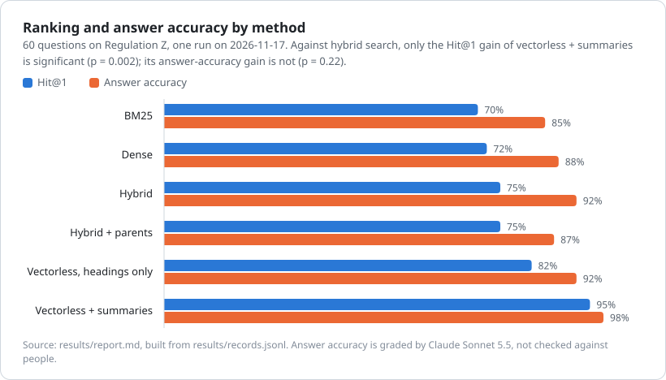
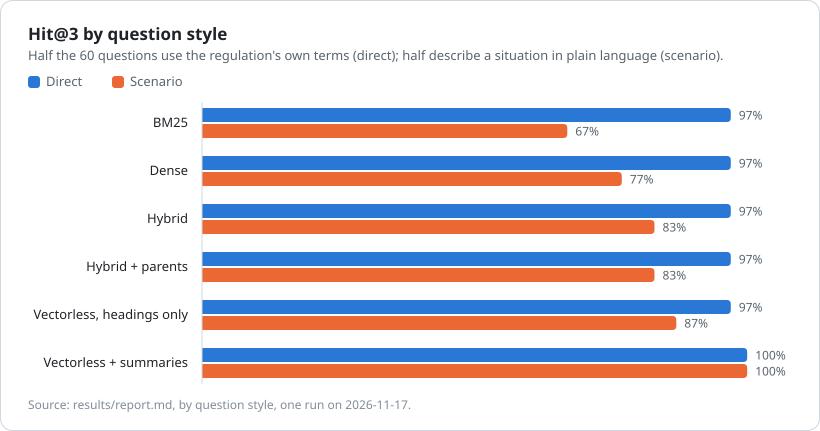

# vectorless-rag-benchmark

[](https://github.com/linusdominic/vectorless-rag-benchmark/actions/workflows/ci.yml)

"Vectorless RAG" drops the vector database: a language model reads a document's outline and
navigates to the answer. This repository builds one and measures it against keyword, vector
and hybrid search on Regulation Z, the US Truth in Lending rule.

| Method | Hit@1 | Hit@3 | Answer accuracy (95% CI) | Retrieval latency p50 | Retrieval cost per query |
| --- | --- | --- | --- | --- | --- |
| BM25 (keywords) | 70% | 82% | 85% (74% to 92%) | 1 ms | $0 |
| Dense (embeddings) | 72% | 87% | 88% (78% to 94%) | 7 ms | $0 |
| Hybrid (BM25 + dense) | 75% | 90% | 92% (82% to 96%) | 8 ms | $0 |
| Vectorless, headings only | 82% | 92% | 92% (82% to 96%) | 3.0 s | $0.00050 |
| Vectorless + index summaries | **95%** | **100%** | **98%** (91% to 100%) | 2.9 s | $0.00127 |

60 questions, 127,851 words of regulation, every number from a run on my machine on
2026-11-17. Full tables are in [results/report.md](results/report.md) and the per-question
records in [results/records.jsonl](results/records.jsonl).

**What the numbers say**

- **Navigating on headings alone is no better than hybrid search.** 82% against 75% at Hit@1
  is 10 questions better and 6 worse, p = 0.45.
- **Adding a model-written summary to each outline entry is what makes it work.** Hit@1 goes
  to 95%: 13 questions better than hybrid and 1 worse, p = 0.002. The gold paragraph was in
  the top three for all 60 questions.
- **The answer-accuracy gap is smaller and not significant at this sample size.** 98% against
  92% is 5 better and 1 worse, p = 0.22.
- **It costs about three seconds per query.** That is roughly 370 times slower than hybrid
  search, plus a tenth of a cent per query with the cheapest current Claude model.

## The question

The approach was popularised by [PageIndex](https://github.com/VectifyAI/PageIndex), whose
headline accuracy figure comes from the vendor's own product. Write-ups since then argue about
it, mostly without measurements: supporters point to accuracy on long structured documents,
critics to cost and latency. I wanted numbers I could reproduce, on a document from the
domain I work in.

Regulation Z (12 CFR Part 1026) suits the test. It is long, strictly hierarchical, full of
cross-references, and repeats near-identical wording in different parts: § 1026.5 and
§ 1026.17 are both titled "General disclosure requirements", one for open-end credit and one
for closed-end.

## What is compared

<picture>
  <source media="(prefers-color-scheme: dark)" srcset="docs/img/architecture-dark.svg">
  
</picture>

All methods are scored on the same unit, the top-level paragraph (for example
`1026.43(c)`), of which the regulation has 352 in 59 sections.

| Method | How it retrieves | Index | Text sent to the answering model |
| --- | --- | --- | --- |
| `bm25` | Okapi BM25 over 941 chunks | Term statistics | Top 5 chunks |
| `dense` | Cosine similarity, `bge-small-en-v1.5` embeddings | 941 vectors | Top 5 chunks |
| `hybrid` | Reciprocal rank fusion of the two above | Both | Top 5 chunks |
| `hybrid+parents` | Same ranking as `hybrid` | Both | The whole top 3 paragraphs |
| `vectorless` | A model picks sections from the table of contents, then paragraphs from their outline | The document's own structure, no model calls | The whole top 3 paragraphs |
| `vectorless+summaries` | Same, with a model-written summary on each outline entry | 363 summaries, written once | The whole top 3 paragraphs |

`hybrid+parents` is a control. The vectorless methods hand the answering model whole
paragraphs, which is more text than five chunks. The control gives hybrid search the same
advantage, to separate "better ranking" from "more context".

## Results

<picture>
  <source media="(prefers-color-scheme: dark)" srcset="docs/img/results-dark.svg">
  
</picture>

| Method | Hit@1 | Hit@3 | Hit@5 | MRR@5 | Answer accuracy (95% CI) | Retrieval latency p50 | Retrieval cost per query |
| --- | --- | --- | --- | --- | --- | --- | --- |
| bm25 | 70% | 82% | 92% | 0.78 | 85% (74% to 92%) | 1 ms | $0 |
| dense | 72% | 87% | 90% | 0.80 | 88% (78% to 94%) | 7 ms | $0 |
| hybrid | 75% | 90% | 92% | 0.82 | 92% (82% to 96%) | 8 ms | $0 |
| hybrid+parents | 75% | 90% | 92% | 0.82 | 87% (76% to 93%) | 8 ms | $0 |
| vectorless | 82% | 92% | 95% | 0.87 | 92% (82% to 96%) | 3.0 s | $0.00050 |
| vectorless+summaries | 95% | 100% | 100% | 0.97 | 98% (91% to 100%) | 2.9 s | $0.00127 |

| Method | Right section in top 3 | Said "not found" | Latency p90 | Retrieval tokens per query | Context sent to the answer model |
| --- | --- | --- | --- | --- | --- |
| bm25 | 87% | 15% | 1 ms | 0 | 5,125 chars |
| dense | 95% | 8% | 10 ms | 0 | 5,092 chars |
| hybrid | 97% | 5% | 10 ms | 0 | 5,097 chars |
| hybrid+parents | 97% | 8% | 10 ms | 0 | 11,911 chars |
| vectorless | 95% | 7% | 3.4 s | 3,899 | 8,606 chars |
| vectorless+summaries | 100% | 0% | 3.3 s | 11,587 | 8,187 chars |

Hit@k is the share of questions whose gold paragraph is in the top k. Answer accuracy is the
share of final answers a grading model marked correct against a reference answer. Intervals
are 95% Wilson intervals.

### Paired comparison with hybrid search

Sixty questions give wide intervals, so each method is also compared with hybrid question by
question, using an exact McNemar test.

| Method vs hybrid | Hit@1: better / worse | Hit@1: p | Answer: better / worse | Answer: p |
| --- | --- | --- | --- | --- |
| bm25 | 2 / 5 | 0.453 | 2 / 6 | 0.289 |
| dense | 4 / 6 | 0.754 | 0 / 2 | 0.500 |
| hybrid+parents | 0 / 0 | 1.000 | 0 / 3 | 0.250 |
| vectorless | 10 / 6 | 0.454 | 5 / 5 | 1.000 |
| vectorless+summaries | 13 / 1 | 0.002 | 5 / 1 | 0.219 |

Only one difference in this table is statistically solid: `vectorless+summaries` ranks the
right paragraph first more often than hybrid search does.

### Plain-language questions are where the methods separate

Half the questions use the regulation's own terms ("direct"). Half describe a situation the
way a borrower or loan officer would ("scenario").

<picture>
  <source media="(prefers-color-scheme: dark)" srcset="docs/img/by-style-dark.svg">
  
</picture>

| Method | direct: Hit@3 | direct: answer accuracy | scenario: Hit@3 | scenario: answer accuracy |
| --- | --- | --- | --- | --- |
| bm25 | 97% | 93% | 67% | 77% |
| dense | 97% | 97% | 77% | 80% |
| hybrid | 97% | 97% | 83% | 87% |
| hybrid+parents | 97% | 93% | 83% | 80% |
| vectorless | 97% | 97% | 87% | 87% |
| vectorless+summaries | 100% | 100% | 100% | 97% |

When the question shares the document's vocabulary, every method finds the paragraph and
there is nothing to buy. The gap opens when it does not.

### More context was not the reason

`hybrid+parents` sent the answering model more than twice the text of `hybrid` (11,911
characters against 5,097) with identical ranking, and scored 87% against 92%. That is three
questions and within noise, but it points the same way: the vectorless gain comes from
ranking the right paragraph higher, not from sending more of the document.

### What the misses look like

**Hybrid search confuses look-alike sections.** Asked when a creditor must make the general
disclosures for a closed-end transaction, it returned § 1026.5(a) and (b) first, the
identically titled open-end section, and ranked the right paragraph seventh. The navigator
read the table of contents, saw one section under "Open-End Credit" and one under
"Closed-End Credit", and opened the right one.

**Headings hide content.** Without summaries the navigator missed three questions, two of
them at the first step. Both were about lenders using a college's name or mascot in
marketing. The rule sits in § 1026.48, titled "Limitations on private education loans",
and nothing in that title suggests it. With a summary on the entry, it was found.

| Method | Found the gold paragraph | Missed at step 1 (wrong sections) | Missed at step 2 (right section, wrong paragraphs) |
| --- | --- | --- | --- |
| vectorless | 57 | 2 | 1 |
| vectorless+summaries | 60 | 0 | 0 |

### What it cost

The whole benchmark cost $1.34 in model calls ([results/spend.json](results/spend.json)),
including a pilot run and debugging: about $0.36 to write the questions, $0.07 for the 363
index summaries, and $0.90 for the evaluation runs. Prices are Anthropic list prices as of
2026-11-03: Claude Haiku 5.5 at $0.10 / $0.50 per million input / output tokens, Claude
Sonnet 5.5 at $2 / $10.

At a million queries a month, `vectorless+summaries` would add about $1,270 of retrieval
spend and three seconds to every answer. Hybrid search adds neither.

## So when is it worth it?

On this evidence:

- **Default to hybrid search.** It is free per query, answers in milliseconds, and its
  answer accuracy was not significantly worse.
- **Consider vectorless retrieval with summaries** when the documents are long and well
  structured, users phrase questions unlike the text, a wrong citation is costly, and a
  three-second wait is acceptable. Compliance research fits that description. A chat
  product with heavy traffic does not.
- **Do not bother with headings-only navigation.** It paid the latency and matched hybrid.

A router that tries hybrid first and falls back to navigation is the obvious next design.
It is not tested here.

## How the vectorless retriever works

There are no embeddings and no chunks. The index is the regulation's own structure.

1. **Pick sections.** The model sees the table of contents, 59 sections grouped by subpart,
   and returns up to three section ids with one sentence of reasoning.
2. **Pick paragraphs.** It sees the outline of those sections only (each paragraph's id,
   heading, length, and a summary or its opening words) and returns up to five paragraph ids.
3. **Answer.** The whole text of the top three paragraphs goes to the answering model.

Both steps return JSON constrained by a schema, and ids the model invents are discarded. Each
step records its reasoning, so every retrieval can be traced:

```
$ vrbench ask "If a lender charges a prepayment penalty on a qualified mortgage, how many years after closing can it apply?"
section_reasoning: Prepayment penalty limits on qualified mortgages are set in the ability-to-repay
  and qualified mortgage provisions ... specifically 1026.43 ... 1026.32 covers high-cost mortgage
  prepayment penalties and is a secondary candidate.
sections: ['1026.43', '1026.32', '1026.35']
paragraph_reasoning: ... governed by 1026.43(g) on prepayment penalties ...
paragraphs: ['1026.43(g)', '1026.43(e)', '1026.32(d)', '1026.32(b)', '1026.43(b)']
retrieval: 5.19 s, $0.00049

A prepayment penalty must not apply after the three-year period following consummation
(§1026.43(g)(2)(i)). ...
```

The summaries are written once at indexing time by the same cheap model: one entry per
paragraph of 40 words or more, and one per section built from its paragraphs' entries.

## The evaluation set

Sixty questions, each with one gold paragraph and a reference answer
([data/questions.jsonl](data/questions.jsonl)).

- **Sampling.** Paragraphs of 80 words or more are sampled with a fixed seed, at most two
  per section. The set covers 34 of the 59 sections.
- **Writing.** Claude Sonnet 5.5 writes one question and a reference answer per paragraph,
  alternating the direct and scenario styles, and quotes the sentence that contains the
  answer.
- **Grounding check.** A question is kept only if that quoted evidence appears in the gold
  paragraph. Two of 76 drafts were rejected.
- **Manual check.** I read ten randomly chosen questions against their evidence. All ten
  reference answers matched it. The other fifty were not read.
- **Grading.** Claude Haiku 5.5 answers from the retrieved text. Claude Sonnet 5.5 grades
  each answer against the reference, without seeing the retrieved text. An answer of "NOT
  FOUND" counts as wrong.

## Reproduce it

Needs [uv](https://docs.astral.sh/uv/). The tests and the report need nothing else.

```bash
git clone https://github.com/linusdominic/vectorless-rag-benchmark.git
cd vectorless-rag-benchmark
make install
make test      # 49 tests, no network or API key
make report    # rebuild the tables above from the committed records
```

To rerun the benchmark itself, copy `.env.example` to `.env`, add an Anthropic API key, then:

```bash
make fetch       # download Regulation Z from eCFR as of 2026-01-01 (free)
make summarize   # write the index summaries (about $0.07)
make questions   # write the question set (about $0.36)
make bench       # run all six methods (about $0.90)
```

Every paid command stops when total spend reaches a cap, $5 by default
(`vrbench --budget 2 run`). Model responses are cached on disk, so a rerun on the same
machine is free. From a fresh clone the calls are made again, and because model output is
not deterministic the results can differ by a few questions.

## Design decisions

- **Score every method on paragraphs, not chunks.** Chunk-based methods rank chunks, and
  the ranking is collapsed to the paragraphs they came from. Otherwise the methods would be
  measured against different targets.
- **Build the baselines by hand.** BM25 and rank fusion are about sixty lines, and dense
  search over 941 vectors is one matrix product. A vector database would add a service to
  run without changing a single number.
- **Use the document's structure as the tree.** PageIndex builds its tree with model calls
  because PDFs do not expose one. The eCFR XML does, so the structure-only index costs
  nothing to build, and the benefit of adding model-written summaries can be measured
  separately.
- **Keep the model fixed.** Server-side model fallback is left off on purpose. A benchmark
  has to know which model produced each result, so a refusal is recorded as a failure.
- **Measure latency per attempt.** Retries are handled in this code, not the SDK, so a
  recorded latency is one successful request and never includes time spent waiting to retry.
- **Meter and cap spend.** Every call is priced from the token usage the API reports and
  added to a ledger on disk. I would not run a benchmark on someone's API key without one.

## Limitations

What this does not show, and what was not verified.

- **The questions are synthetic.** A model wrote each one from a single paragraph. Real
  users ask vaguer, multi-part and unanswerable questions, and none of those are here.
- **The summaries and the questions share a source.** Both are model-written digests of the
  same paragraphs, which may favour `vectorless+summaries`. A hand-written question set is
  the test that would settle it, and there is not one.
- **One gold paragraph per question.** Regulation Z often states a rule in more than one
  place. A method that finds a different correct paragraph is scored as a miss on Hit@k,
  though it can still earn a correct answer.
- **Sixty questions.** Enough to show a 20-point ranking gap, not enough to resolve a
  6-point accuracy gap.
- **One document, and a tidy one.** A regulation with a clean hierarchy is the best case
  for navigation. Nothing here says how it does on scanned PDFs, flat prose, or a corpus of
  thousands of unrelated documents, where the table of contents no longer fits in a prompt.
- **Modest baselines.** The dense retriever uses a small embedding model and there is no
  reranker. A stronger embedding model or a cross-encoder reranker may close the gap, and
  was not tried.
- **The grader was not checked against people.** No human graded the 360 answers.
- **Latency is API response time from one laptop** with six calls in flight. It is not a
  load test, and it will move with the provider's speed.
- **The regulation's appendices and official commentary are excluded.** They are 78% of
  the part's 586,199 words. Only the 59 sections are indexed.
- **Not legal advice.** This measures retrieval. Do not use its output to make a
  compliance decision.

One thing that went wrong during the build: the first full run stalled with six requests
hanging on open connections and no error. The fix was a hard per-request timeout with
retries, which is now tested. The stall did not recur, and its cause was not found.

## Project layout

```
src/vrbench/
  corpus.py               eCFR XML -> sections and top-level paragraphs
  chunking.py             chunks for the baselines
  retrievers/chunked.py   BM25, dense, hybrid (rank fusion), parent expansion
  retrievers/vectorless.py  two-step tree navigation
  summaries.py            index-time summaries
  llm.py                  model client: cache, spend ledger, budget cap, timeout and retries
  questions.py            question generation and the grounding check
  evaluate.py             retrieve -> answer -> grade, per question and method
  report.py               metrics, Wilson intervals, McNemar tests, tables
  cli.py                  the vrbench command
data/                     parsed regulation, summaries, questions
results/                  per-question records, report, spend ledger
tests/                    49 tests with a scripted model
```

## Development

```bash
make test
make lint
```

CI runs both, and checks that the committed records still reproduce the committed report.

## License

MIT. Regulation Z is a work of the US government and is in the public domain; the text in
`data/regz.json` comes from the [eCFR](https://www.ecfr.gov/current/title-12/part-1026).
